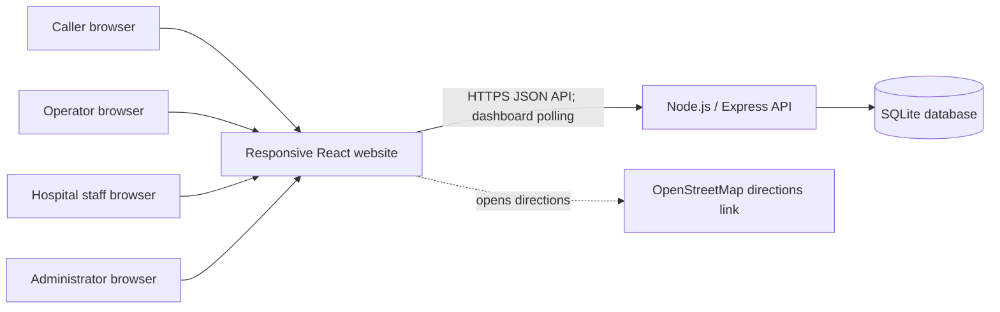
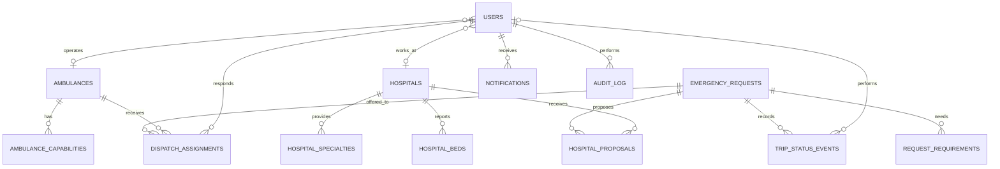

# Ambulance Dispatch and Hospital Coordination System

## Complete Project Specification

**Project type:** Software engineering minor project / academic demonstration  
**Service area:** Chandigarh, Mohali and Panchkula (sample data only)  
**Product form:** One responsive website with role-based pages  
**Specification status:** Simplified and implementation-ready proposal based on the supplied SRS

> **Important scope statement:** This is an academic demonstration. It is not an operational emergency service and must not be used to request real medical assistance. The website demonstrates request intake, matching, dispatch coordination and status tracking using sample records. It does not contact emergency services, send real SMS messages, read a vehicle's live GPS, or reserve real hospital beds.

## How to read this specification

- **Original SRS** identifies a requirement or direction explicitly present in the supplied document.
- **Project decision** is a simplifying choice made for this minor project at the user's request. It resolves an ambiguity so the demo can be built without waiting for further business decisions.
- **Future / out of scope** means the original idea is acknowledged but is not needed to demonstrate the project.

The original SRS names a PWA, Android application, React dashboard, Node.js services, PostgreSQL/PostGIS, Redis, OpenStreetMap routing and ERSS 112 interoperability. The project decision below keeps a website and a Node/React implementation direction, but reduces the system to one web application, one backend and one simple database. These reductions are explicit scope changes for a student project, not claims that the original SRS required them.

## 1. Project overview

The system is a website that demonstrates how an emergency request could be coordinated between a caller, an available ambulance and a hospital. A caller submits a location and, if needed, medical or vehicle requirements. The system checks sample ambulance and hospital records, recommends suitable options and creates a dispatch case. Ambulance and hospital users sign in to accept or update the case. An administrator can maintain the sample fleet and facility records and review cases.

The project addresses a coordination problem: callers may not know which ambulance or hospital can meet a need, and service providers may not have a shared view of incoming cases. The demo brings those steps into one workflow and makes the current case status visible to the relevant users.

### 1.1 Objectives

1. Demonstrate emergency request submission in a small number of steps.
2. Match requests to sample ambulances using availability, capability and approximate distance.
3. Recommend a hospital using capability, open-bed count and approximate distance.
4. Demonstrate acceptance, decline, hospital confirmation and trip status updates.
5. Give each role a focused website dashboard.
6. Preserve a simple case history for review and reporting.
7. Keep the project small enough to build, run and explain as a minor project.

### 1.2 Scope

**Included:** responsive web pages, role-based sign-in, emergency and requirement-based requests, sample locations and facilities, capability matching, case assignment, hospital confirmation, trip statuses, demo notifications, admin CRUD for ambulances and hospitals, basic reports, audit/status history.

**Excluded from the submission version:** Android/iOS apps, native GPS tracking, live traffic and routing, true real-time hospital telemetry, actual bed reservations, payments, clinical advice, real SMS/email/push messages, ERSS 112 integration, multi-agency dispatch, production-grade high availability, and use with real patients.

### 1.3 Success criteria

- A caller can submit a valid demo request and receive a case reference.
- A compatible available ambulance is recommended when one exists.
- A compatible hospital with a positive open-bed count is recommended when one exists.
- The operator and hospital can accept/decline or update their part of the case.
- Each allowed status change is recorded and visible in the case timeline.
- When no match exists, the case remains visible as needing administrator attention and the caller sees a clear message.
- The core flow can be demonstrated using seeded sample accounts and data.

## 2. Stakeholders and user roles

| Role | Intended user | Permissions in the demo |
|---|---|---|
| Caller / attendant | Person requesting demo assistance | Submit a request; see the confirmation page and case reference; look up status using the reference and a verification detail. No account required for the demo. |
| Ambulance operator | Person representing an ambulance crew | Sign in; view cases assigned to their ambulance; accept or decline an offer; update trip status; add a short operational note. |
| Hospital desk staff | Person representing a facility | Sign in; view cases proposed for their hospital; confirm or decline readiness; update sample bed counts. |
| Administrator | Project evaluator or system manager | Manage sample ambulances, hospitals and user accounts; view all cases; manually reassign a case; review status history and summary counts. |

**Project decision:** The SRS combines “ambulance operator/driver” into one demo role and treats hospital desk staff as one role. A separate dispatcher role is not added; the administrator handles exceptions and reassignment. A caller does not need a persistent account to avoid adding account recovery and patient-profile complexity.

## 3. Functional requirements

The IDs below preserve SRS IDs where available. Added requirements use `PR` (project requirement) and are proposed for the demo.

| ID | Requirement | Source / status | Priority |
|---|---|---|---|
| FR-EMG-01 | Accept a caller's coordinates or a selected sample location and create an emergency request. | Original SRS, simplified input | High |
| FR-EMG-02 | Find the nearest available ambulance that satisfies required capabilities. | Original SRS intent; eligibility rule clarified | High |
| FR-EMG-03 | Complete the local matching operation within 2 seconds under the demo's stated workload. | Original SRS target; measured on the demo environment, not a production guarantee | High |
| FR-HOS-01 | Recommend a compatible hospital that has a positive sample bed count and is within the selected maximum distance. | Original SRS intent; simplified to stored sample values | High |
| FR-REQ-01 | Support requirement choices: ICU transport, ventilator, oxygen, cardiac support, paramedic assistance, stretcher and neonatal care. | Original SRS | High |
| FR-REQ-02 | Allow optional hospital preferences for ownership, specialty, emergency department status and maximum distance. | Original SRS | Medium |
| FR-DIS-01 | Rank eligible ambulances by approximate distance, capability fit and estimated travel time where available. | Original SRS, scoring made deterministic below | High |
| FR-HOS-02 | Allow hospital staff to update demo emergency, ICU and ventilator bed counts. | Original SRS intent | High |
| FR-DIS-02 | Require operator acceptance before a case becomes an active trip. | Project decision | High |
| FR-HOS-03 | Require hospital readiness confirmation before the trip is marked ready to transport. | Project decision | High |
| FR-NAV-01 | Show approximate distances and an OpenStreetMap directions link. Do not calculate live traffic routes. | Original SRS, simplified | Medium |
| FR-NOT-01 | Show in-website notifications and status badges on role dashboards. | Original SRS, simplified from WebSocket/SMS | High |
| PR-01 | Provide public request form, caller status lookup, operator dashboard, hospital dashboard and admin dashboard. | Proposed for website scope | High |
| PR-02 | Record every case status transition with actor and timestamp. | Proposed for traceability | High |
| PR-03 | Provide administrator summary counts for requests, active trips, completed cases and cases needing attention. | Proposed, small reporting scope | Medium |
| PR-04 | Seed demo users, ambulances, hospitals, capabilities and example cases. | Proposed for reliable presentation | High |

## 4. Main features and workflows

### 4.1 Caller request

**Purpose/access:** Let a caller/attendant create a demo case without navigating provider dashboards.

**Inputs:** request type (emergency or requirement-based), location (select from sample locations or enter coordinates), required capabilities, optional hospital preference filters, contact name/phone (optional demo fields), and short notes (optional). The form must clearly say this is a demo.

**Successful flow:**

1. Caller opens “Request Assistance.”
2. Caller chooses emergency or requirement-based request. Emergency defaults to the simplest request with no requirement fields forced.
3. Caller chooses or enters a location. The site validates latitude/longitude and that the point falls within the configured demo service area.
4. Caller selects any required capabilities and optional hospital filters.
5. Backend validates the input and creates the request with status `MATCHING`.
6. Backend finds an ambulance and a hospital using the rules in section 5.
7. If both are found, the case is assigned to the ambulance as an offer and proposed to the hospital. A unique case reference is returned; the case appears on the operator and hospital dashboards.
8. Caller sees the case reference, recommended ambulance/hospital status and a status lookup option.

**Failure flow:** Invalid location or missing required form data returns field-level errors without creating a case. If location is outside the sample boundary, caller is asked to select a supported demo location. If no ambulance or hospital is found, create the case in `NEEDS_REVIEW`, show that the demo could not assign resources automatically, and make it visible to the administrator. Never show “help is on the way” unless an operator accepted the offer.

### 4.2 Ambulance matching and operator decision

1. System filters ambulances to `AVAILABLE` and in-service records.
2. It filters to ambulances whose capability set includes every hard requirement in the request.
3. It ranks the eligible set using distance, capability fit and the sample ETA estimate. The nearest eligible ambulance is first by default; tie-breaks use capability fit, then stable ambulance ID ordering.
4. The first ambulance receives a pending offer in its dashboard.
5. Operator accepts or declines. Acceptance changes ambulance to `ASSIGNED` and request to `AMBULANCE_ACCEPTED`. Decline returns the ambulance to `AVAILABLE` and offers the case to the next candidate.
6. If all candidates decline or the offer remains unanswered for 2 minutes, the system tries the next candidate. When none remain, mark `NEEDS_REVIEW` and notify the administrator in the site.
7. Administrator may re-run matching or manually choose an available compatible ambulance. Every manual reassignment is logged.

The two-minute timeout is a **project decision** for a predictable demo. It is not an operational emergency-service standard.

### 4.3 Hospital matching and confirmation

1. System filters hospitals to active facilities with emergency department enabled, appropriate selected specialty/capability and positive relevant bed count.
2. Apply any caller-selected ownership or maximum-distance filters.
3. Rank remaining hospitals by distance, capability fit and sample ETA, using the same stable tie-break convention.
4. Hospital staff see a pending case proposal with limited demo information: case reference, requirements, approximate ETA and relevant sample vitals only if explicitly entered (vitals are optional and not clinically validated).
5. Staff confirms readiness or declines with a reason. Confirmation changes the case to `READY_FOR_PICKUP` only after ambulance acceptance. Decline leads to the next suitable hospital candidate. If no hospital remains, case becomes `NEEDS_REVIEW` for the administrator.
6. Confirmation does not decrement or lock a real bed. For the demo, the selected bed count is treated as a capacity check at the moment of matching; the application may display a temporary “held for this case” count to prevent two demo cases consuming the same sample capacity. The hold expires when declined, cancelled, completed or after the case is manually closed.

### 4.4 Trip status updates

Allowed sequence: `OFFERED` -> `ACCEPTED` -> `EN_ROUTE_TO_CALLER` -> `PATIENT_PICKED_UP` -> `EN_ROUTE_TO_HOSPITAL` -> `HANDOVER_COMPLETE` -> `CLOSED`.

An operator may decline an `OFFERED` case. Hospital readiness is recorded separately and does not rewrite the ambulance trip status. Admin may cancel or reassign with a mandatory reason. The system rejects out-of-order transitions and tells the user which state is expected. A completed handover closes the case and returns the ambulance to `AVAILABLE`.

### 4.5 Hospital availability management

Hospital staff can view and edit the sample counts for emergency, ICU and ventilator beds. Values must be non-negative whole numbers. A count of zero makes that facility ineligible for requests requiring that resource. All updates record who changed the values and when. The system does not claim that these demo counts represent real hospital capacity.

### 4.6 Administration and reporting

Admin pages support adding/editing/deactivating users, ambulances and hospitals; reviewing all cases; retrying matching; manually assigning compatible resources; cancelling demo cases; and viewing summary counts and status history. Hard deletion of records referenced by cases is prevented; deactivation is used instead. No advanced analytics or jurisdiction management is included.

## 5. Business rules and edge-case decisions

| Rule | Demo behavior |
|---|---|
| Eligibility before ranking | Availability, in-service state and every required capability are hard filters. A nearer but incapable vehicle is not eligible. |
| Ambulance ranking | Use straight-line Haversine distance from request point to last stored ambulance point. If sample ETA exists, use it as the final ranking factor. Capability fit is a tie-breaker after all hard requirements. No live traffic factor. |
| Hospital eligibility | Facility active, ER enabled, within optional distance, requested specialty/resource supported and relevant bed count positive. If ICU/ventilator is requested, corresponding count must be positive. |
| Ambiguous weighted SRS formula | Original formula has no units, normalization or score direction. Project decision replaces it with the explicit filter-and-sort rules above so the result is deterministic and explainable. |
| Missing GPS permission/device | No device GPS dependency. Caller selects a sample map point or enters coordinates. If invalid, request is not submitted. |
| Location outside service area | Show supported service area and block automatic assignment; allow admin review of the created case only if the location is valid but outside the configured polygon. |
| No eligible ambulance | Keep case `NEEDS_REVIEW`, show clear caller message, alert admin in-site. Admin can update fleet sample availability and retry. |
| Operator decline/timeout | Offer next eligible ambulance; after all options are exhausted, `NEEDS_REVIEW`. |
| No eligible hospital / hospital declines | Try next eligible hospital. If exhausted, `NEEDS_REVIEW`; operator must not mark `EN_ROUTE_TO_HOSPITAL` until admin assigns a destination. |
| Double assignment race | Assignment is committed in one database transaction only if ambulance is still `AVAILABLE`. If another case has assigned it, recalculate and try the next candidate. |
| Double bed use | Use a transactional temporary capacity hold for the demo; do not allow held count to exceed configured count. Release the hold on decline, cancellation, completion or admin closure. |
| Duplicate form submit | Client sends an idempotency token; if repeated, return the original case reference rather than creating another case. |
| Caller cancels | Caller may cancel only before an operator accepts. After acceptance, cancellation is routed to admin for the demo; operator and hospital are notified in-site and resources are released after admin confirms. |
| Wrong or stale status action | Reject transition with `409 Conflict`; dashboard refresh shows current status. No status is silently overwritten. |
| Network interruption | Show save/submit error; do not claim that the request was created unless backend returned a case reference. On dashboard interruption, retry reads; operator must confirm status update after connection returns. |
| Offline operator | No offline queue in this simplified website. A pending case remains offered until timeout and moves to the next ambulance. |
| Notification failure | State change remains saved; notification is best effort. Dashboard refresh reveals the authoritative state. |
| Invalid/negative capacity | Reject with field error; keep prior value. |
| Admin manual override | Allow only compatible active resources unless admin enters an override reason; record actor, time and reason. The demo should discourage unsafe overrides by requiring an explicit confirmation. |
| All matching options fail | Case remains visible as `NEEDS_REVIEW`; caller sees a non-promissory message. No simulated 112 call is made. |

## 6. Non-functional requirements

| Category | Requirement for the minor project |
|---|---|
| Performance | Matching returns within 2 seconds for seeded data and local test load. This is a demo target; it is not a production guarantee. |
| Availability | Run locally or on one student hosting environment. Original 99.99% uptime target is out of scope for a minor project. |
| Scale | Data model should support the SRS sample scale (2,000 ambulances/150 facilities), but the submission need only demonstrate modest seeded data. |
| Usability | Request form should be usable on a phone-sized browser and keep emergency submission to at most three major interactions where practical. |
| Security | Password hashes, role-based access checks, input validation, HTTPS when hosted, no secrets in source control. Use synthetic data only. |
| Privacy | Collect minimum demo data; mask phone in provider views; no real patient names or medical records. Provide a demo notice. |
| Reliability | Database transaction for resource assignment and capacity holds; state transitions validated on server. |
| Maintainability | One frontend, one backend and one database; clear module boundaries; setup documented in README. |
| Accessibility | Labels, keyboard access, visible focus, readable contrast and error summaries for forms. |
| Compatibility | Current desktop and mobile browsers; no installed application required. |

## 7. Proposed system architecture

### 7.1 Component structure

### 7.2 Frontend

One responsive React application serves all roles. Routes/pages are protected by role. The public caller pages do not require login. Role dashboards refresh data periodically (for example every 10 seconds) and have a manual refresh control. This replaces the SRS WebSocket and native app requirements for the demo.

### 7.3 Backend

One Node.js/Express application provides REST endpoints, authentication, validation, matching, status transitions, admin operations and audit logging. Keep modules separated in code (auth, requests, matching, ambulances, hospitals, cases, reports) while deploying as a single process. A background worker or microservices are unnecessary.

### 7.4 Database

SQLite is recommended for low setup effort and a self-contained submission. Use foreign keys and transactions. It does not provide PostGIS; distance is calculated in application code using Haversine. If the evaluator requires the SRS's PostgreSQL/PostGIS specifically, change SQLite to PostgreSQL and keep the same logical schema; that is an implementation choice, not an open business decision.

### 7.5 Authentication and authorization

Use username/email and password for operator, hospital and admin accounts. Store salted password hashes. Use a server session in an HTTP-only, secure, same-site cookie when hosted over HTTPS. Each API checks both authentication and role. Caller status lookup uses a random case reference plus a short verification detail or one-time lookup token; it must not expose a list of cases.

### 7.6 External services

- **Maps:** Store sample coordinates and generate an OpenStreetMap directions URL. The demo does not request live route/traffic data.
- **Notifications:** Create in-app notification records and show dashboard badges. No external SMS, email, push service or WebSocket is required.
- **ERSS 112:** Not called. The interface is out of scope until an authorized API specification and operational approval exist.

### 7.7 Deployment

For submission, run frontend and backend locally with a seeded SQLite file, or deploy both to one student-accessible host. Use environment variables for session secrets and database path. Include a seed/reset command and demo accounts in the README (with sample-only passwords). Back up the SQLite file before a demo. No active-passive failover is proposed.

## 8. Database design

Data types below are logical types; adapt `BOOLEAN`, timestamp and JSON representations to the chosen database. IDs use UUID strings or integer primary keys consistently; integer primary keys are simplest for SQLite. Password fields contain hashes only.

### 8.1 Entities

| Table | Important fields and constraints | Purpose |
|---|---|---|
| `users` | `id` PK; `name`; `email` UNIQUE; `password_hash`; `role` CHECK in `OPERATOR`, `HOSPITAL`, `ADMIN`; nullable `ambulance_id` FK; nullable `hospital_id` FK; `active`; `created_at` | Login identities for provider and admin roles. Exactly one of ambulance/hospital link is set for the corresponding provider role. |
| `ambulances` | `id` PK; `call_sign` UNIQUE; `type` (`ALS`,`BLS`,`NEONATAL`); `status` (`AVAILABLE`,`OFFERED`,`ASSIGNED`,`OUT_OF_SERVICE`); `latitude`; `longitude`; `in_service`; `last_seen_at`; `created_at`; `updated_at` | Sample fleet and its latest manually stored position. |
| `ambulance_capabilities` | `ambulance_id` FK; `capability_code`; composite PK (`ambulance_id`,`capability_code`) | Many-to-many association between ambulances and capabilities. Codes include oxygen, ventilator, cardiac, stretcher, paramedic, neonatal. |
| `hospitals` | `id` PK; `name`; `ownership` (`GOVERNMENT`,`PRIVATE`); `latitude`; `longitude`; `emergency_enabled`; `active`; `phone_demo`; `created_at`; `updated_at` | Sample facilities and searchable properties. |
| `hospital_specialties` | `hospital_id` FK; `specialty_code`; composite PK | Many-to-many association between hospitals and specialties/capabilities. |
| `hospital_beds` | `id` PK; `hospital_id` FK; `bed_type` (`EMERGENCY`,`ICU`,`VENTILATOR`); `total_count`; `held_count`; `updated_by` FK users; `updated_at`; UNIQUE (`hospital_id`,`bed_type`); CHECK counts >= 0 and held <= total | Sample capacity with temporary holds for active demo cases. Available count = total - held. |
| `emergency_requests` | `id` PK; `public_reference` UNIQUE; `lookup_token_hash`; `request_type`; `status`; `latitude`; `longitude`; `location_label`; `requirements_json` or normalized child rows; `ownership_filter`; `specialty_filter`; `max_distance_km`; optional `caller_name`; optional `caller_phone`; `notes`; `created_at`; `updated_at`; `cancelled_at` | Caller-submitted case data and current top-level state. Store only synthetic contact values in the submission demo. |
| `request_requirements` | `request_id` FK; `capability_code`; composite PK | Normalized list of required capabilities. |
| `dispatch_assignments` | `id` PK; `request_id` FK; `ambulance_id` FK; `operator_user_id` FK; `state`; `offered_at`; `responded_at`; `expires_at`; `decline_reason`; `is_current`; UNIQUE partial/current assignment rule | Records ambulance offers, acceptance and decline history. At most one current assignment per request and at most one active case per ambulance. |
| `hospital_proposals` | `id` PK; `request_id` FK; `hospital_id` FK; `state`; `offered_at`; `responded_at`; `decline_reason`; `bed_hold_id` nullable FK; `is_current` | Tracks hospital choices and decisions, including alternatives. |
| `trip_status_events` | `id` PK; `request_id` FK; `actor_user_id` nullable FK; `old_status`; `new_status`; `note`; `created_at` | Immutable history of status changes. |
| `notifications` | `id` PK; `user_id` FK; `request_id` nullable FK; `type`; `message`; `read_at`; `created_at` | In-website alerts; may be regenerated from authoritative case state if needed. |
| `audit_log` | `id` PK; `actor_user_id` FK; `action`; `entity_type`; `entity_id`; `reason`; `created_at` | Admin override and sensitive data change history. Do not store passwords or unnecessary patient data here. |

### 8.2 Relationships

- One ambulance has many operator users over time (or one active operator in the simple seed setup); one operator account belongs to one ambulance.
- One hospital has many hospital staff accounts and multiple bed-type rows.
- Ambulances and capabilities are many-to-many through `ambulance_capabilities`.
- Hospitals and specialties are many-to-many through `hospital_specialties`.
- One emergency request has many dispatch offer records, hospital proposals, status events and notifications.
- One ambulance may have many historical assignments but at most one active assignment.
- One hospital proposal may have one temporary capacity hold.

### 8.3 Indexes and integrity rules

Index `emergency_requests(status, created_at)`, `dispatch_assignments(ambulance_id, state)`, `hospital_proposals(hospital_id, state)`, `notifications(user_id, read_at)`, and all foreign keys used for joins. Add unique indexes for user email, ambulance call sign, public reference, and one current assignment/proposal per case. Latitude must be -90..90 and longitude -180..180. Bed counts must be non-negative and held count cannot exceed total. Assignment and hold changes must be transactional.

### 8.4 ER diagram

## 9. API and backend operations

All API responses use JSON. Authenticated routes require a valid session and role. The examples are proposed contracts; names can be adapted during implementation. Error envelope: `{"error":{"code":"VALIDATION_ERROR","message":"...","fields":{}}}`.

| Method and endpoint | Purpose / role | Request | Success / errors |
|---|---|---|---|
| `POST /api/auth/login` | Sign in provider/admin | `{email,password}` | `200 {user:{id,name,role}}`; `401` invalid login; `403` inactive account. |
| `POST /api/auth/logout` | End session / signed-in user | empty | `204`; `401` if no session. |
| `GET /api/auth/me` | Current identity / signed-in user | none | `200 {user}`; `401`. |
| `POST /api/requests` | Create caller request / public | request type, coordinates/location, requirements, optional filters/contact, idempotency key | `201 {reference,status,ambulance,hospital}`; `400` invalid fields; `422` outside area; `409` duplicate conflict if idempotency mismatch. Matching occurs server-side. |
| `POST /api/requests/status-lookup` | Caller checks own case / public | `{reference,lookupToken}` | `200 {reference,status,eventsSummary}`; `404` invalid reference/token. Rate-limit repeated failures. |
| `GET /api/operator/requests` | List offers/trips / OPERATOR | optional status | `200 {items:[]}`; `401/403`. Return only records for the user's ambulance. |
| `POST /api/assignments/{id}/decision` | Accept/decline ambulance offer / OPERATOR | `{decision:"ACCEPT"|"DECLINE",reason?}` | `200 {assignment,requestStatus}`; `400` invalid reason; `403` wrong ambulance; `409` stale offer/state. Decline invokes next-candidate matching. |
| `POST /api/requests/{id}/trip-status` | Advance trip / OPERATOR | `{status,note?}` | `200 {status}`; `403`; `409` out-of-order transition; `404`. |
| `GET /api/hospital/proposals` | List hospital cases / HOSPITAL | optional status | `200 {items:[]}`; only own hospital's proposals. |
| `POST /api/hospital-proposals/{id}/decision` | Confirm/decline / HOSPITAL | `{decision,reason?}` | `200 {proposal,requestStatus}`; `403`; `409`; `404`. Decline proposes next hospital. |
| `GET /api/hospital/beds` | Read own sample capacity / HOSPITAL | none | `200 {beds:[]}`; `403`. |
| `PUT /api/hospital/beds/{bedType}` | Update sample capacity / HOSPITAL | `{totalCount}` | `200 {bed}`; `400` negative/non-integer or below held count; `403`; `404`. |
| `GET /api/admin/requests` | View all cases / ADMIN | filters: status, date | `200 {items:[]}`; `403`. |
| `POST /api/admin/requests/{id}/retry-matching` | Retry matching / ADMIN | optional reason | `200 {status,assignment,hospital}`; `409` case not eligible; `404`. |
| `POST /api/admin/requests/{id}/assign` | Manual compatible reassignment / ADMIN | `{ambulanceId,hospitalId,reason}` | `200 {assignment,proposal}`; `400` missing reason/incompatible resources; `409` resource no longer available. |
| `POST /api/admin/requests/{id}/cancel` | Cancel case / ADMIN | `{reason}` | `200 {status:"CANCELLED"}`; `400` missing reason; `409` already closed. Releases holds and resources. |
| `GET /api/admin/ambulances` / `POST /api/admin/ambulances` / `PUT /api/admin/ambulances/{id}` | Fleet CRUD / ADMIN | fields from ambulance table | `200/201`; `400` invalid values; `403`; `404`; `409` duplicate call sign or active assignment prevents unsafe edit. |
| `GET /api/admin/hospitals` / `POST /api/admin/hospitals` / `PUT /api/admin/hospitals/{id}` | Facility CRUD / ADMIN | fields from hospital table | `200/201`; `400`; `403`; `404`; `409` invalid capacity relationship. |
| `GET /api/admin/reports/summary` | Dashboard counts / ADMIN | date range | `200 {counts:{...}}`; `400` invalid dates; `403`. |
| `GET /api/notifications` / `POST /api/notifications/{id}/read` | In-app notifications / signed-in user | none | `200`; records scoped to current user; `403/404`. |

### 9.1 Backend processing rules

- Validate all inputs on the server; client validation is only for usability.
- Request creation, candidate lookup and initial offer creation should be consistent. Use a database transaction to claim an ambulance only if it remains available.
- A request cannot be marked as accepted until the operator account linked to the offered ambulance accepts it.
- A request cannot proceed to transport-to-hospital until a destination hospital is confirmed or assigned by admin.
- Every status change records actor, timestamp, previous state and new state.
- Declines and timeouts are terminal for that specific offer, not the whole request; matching advances to the next candidate.
- If no candidate remains, mark `NEEDS_REVIEW` and create an administrator notification.
- Notification failures must not roll back a successful state change.

## 10. UI/UX screen requirements

| Screen | Role | Main content/actions | Validation and navigation |
|---|---|---|---|
| Demo landing page | Public | Project purpose, demo warning, “Request assistance,” “Check case status,” sign-in links | Warning visible; routes to request form or lookup. |
| Emergency request form | Caller | Emergency/requirement mode, sample map/location picker or coordinates, capability checkboxes, optional hospital filters, optional contact/note, submit | Required location, valid coordinate range, capability choices; errors inline; submit -> confirmation. |
| Request confirmation | Caller | Case reference, current status, assigned/proposed resource summaries, lookup link | Do not imply dispatch before operator acceptance; navigation to status lookup. |
| Case status lookup | Caller | Reference and lookup token, status timeline, current high-level result | Invalid pair gives generic error; never reveal other cases. |
| Sign-in | Operator/hospital/admin | Email, password | Required fields, generic invalid-login message; routes by role. |
| Operator dashboard | Operator | Offers, active trip, assignment details, approximate distance/directions link, accept/decline, status buttons and notes | Only linked ambulance cases; disable invalid transitions; confirmation for decline. |
| Hospital dashboard | Hospital | Pending proposals, case requirements/ETA, confirm/decline, bed counts editor | Only own facility; non-negative integer capacities; reason for decline. |
| Admin dashboard | Admin | Counts, cases needing review, recent updates, search/filter | Links to case detail, fleet, facilities and reports. |
| Case detail and timeline | Admin; limited case view to involved provider | Request summary, resources, offer decisions, status history, retry/reassign/cancel for admin | Require reason for override; prevent incompatible assignment; confirm destructive actions. |
| Ambulance management | Admin | Add/edit/deactivate vehicle, type, capabilities, sample coordinates, status | Unique call sign, valid coordinates, cannot make assigned vehicle available while active case exists. |
| Hospital management | Admin | Add/edit/deactivate facility, ownership, specialty, coordinates, ER enabled and bed counts | Unique/required fields, valid coordinates, bed counts >= held counts. |
| User management | Admin | Create/deactivate demo accounts, link provider account to ambulance/hospital, reset demo password | Unique email, valid role/link, never display stored hash. |
| Summary report | Admin | Totals by status, completed cases, cases needing review, date filter | Clear empty state; export is optional and out of initial scope. |

## 11. Authentication, authorization and security

- Public users may create a request and look up only a case when they possess its reference and verification token.
- Operators can see and modify only cases offered to their linked ambulance.
- Hospital staff can see and modify only proposals for their linked facility.
- Admin can manage all demo records and perform overrides; override reasons are mandatory.
- Hash passwords using a maintained password hashing library (Argon2id or bcrypt). Never store plaintext passwords.
- Use session cookies with `HttpOnly`, `Secure` in HTTPS deployments, and `SameSite`; protect state-changing cookie-authenticated routes against CSRF.
- Validate and encode input/output to reduce injection and cross-site scripting risks. Use parameterized SQL.
- Apply basic login and public lookup rate limits. Avoid exposing whether a case reference exists in error details.
- Use HTTPS when hosted. Keep secret keys outside source code.
- Use fabricated names, phone numbers, vitals and locations in screenshots/demo. Do not place real health information in the project database.

## 12. Error handling

Show a clear message and next step, preserve safe form inputs, and avoid technical stack traces in the UI. Use consistent HTTP codes: `400` malformed/invalid input, `401` unauthenticated, `403` wrong role/resource scope, `404` unavailable record, `409` invalid current-state transition or race, `422` validly formed but out-of-scope location, `429` rate limit, `500` unexpected server error.

Log server errors with a request ID and timestamp; do not log passwords, lookup tokens, or unnecessary patient details. On API timeout, show “Could not confirm submission; check case status before retrying” unless the server confirms failure. Dashboard reads can be retried; a state-changing action should be retried only with an idempotency key or after checking current state.

## 13. Notifications and integrations

The SRS proposes WebSocket/SMS alerts, OSM dynamic routing and ERSS 112 integration. The minor project uses in-app notification records, periodic dashboard refresh and an OpenStreetMap link based on sample coordinates. No SMS, push, live traffic or ERSS request is sent. All notification text must identify the case reference and current state without claiming a real service response.

## 14. Testing strategy and example cases

Testing is planned as a submission requirement; these are test cases, not a claim that implementation has already been tested.

| Test ID | Area / scenario | Expected result |
|---|---|---|
| T01 | Submit valid emergency request at sample location | One case reference created; matching results displayed. |
| T02 | Submit with missing/invalid coordinates | Field error; no request or assignment created. |
| T03 | Submit outside configured service polygon | Clear unsupported-area message; no automatic dispatch. |
| T04 | Ambulance is nearer but lacks a required ventilator | It is excluded; nearest compatible ambulance is offered. |
| T05 | No eligible ambulance exists | Case marked `NEEDS_REVIEW`; admin dashboard shows it; caller sees no false dispatch claim. |
| T06 | First operator declines, second ambulance is eligible | First offer closes; second receives offer; first ambulance returns to available. |
| T07 | Operator does not answer before offer expiry | Next eligible ambulance receives offer; exhausted list becomes `NEEDS_REVIEW`. |
| T08 | Two requests attempt to take the same ambulance concurrently | Only one assignment succeeds; the other is rematched or marked for review. |
| T09 | Hospital declines a proposal | Next eligible hospital is proposed; reason appears in case timeline. |
| T10 | Required ICU bed count is zero | Hospital is excluded from ICU request matching. |
| T11 | Staff set bed count below current held count | Update rejected; prior capacity remains unchanged. |
| T12 | Caller lookup uses incorrect token | Generic not-found response; no case data disclosed. |
| T13 | Operator accesses another ambulance's case ID | API returns forbidden/not found; no data returned. |
| T14 | Operator attempts to skip from accepted to handover | API rejects with conflict and expected next state. |
| T15 | Admin manually assigns an incompatible ambulance | API rejects; requires compatible resource or explicit audited override. |
| T16 | Duplicate request submission with same idempotency key | Same case returned; no duplicate case created. |
| T17 | Dashboard notification read fails after a status update | Status remains saved; dashboard can retrieve current authoritative state. |
| T18 | Hospital/operator user deactivated during session | Subsequent protected request is denied. |
| T19 | SQL injection-like text entered in note field | Stored/displayed safely as text; database structure unaffected. |
| T20 | Responsive request form at mobile viewport | Fields and primary action remain visible and usable without horizontal scrolling. |
| T21 | Matching load with seeded fleet and concurrent synthetic requests | Matching remains correct; local response target under 2 seconds is measured and recorded. |
| T22 | Complete a full case from request through handover | Correct status order, resource release and audit timeline. |

Test types: unit tests for validators/matching/state machine; API tests for roles and error responses; database tests for constraints and transaction races; integration tests for full request-to-handover; security checks for authentication/authorization and unsafe inputs; responsive/usability review; user acceptance walkthrough using the seeded demo accounts.

## 15. Deployment and operations

- Provide a one-page setup guide with prerequisites, install/start steps and seed/reset instructions.
- Keep a repeatable seed dataset: at least three ambulances of varied capabilities, three hospitals with different sample capacities, one account per provider role and one admin account.
- Include a demo script that shows one successful request and one no-match/decline path.
- Do not expose admin demo credentials on a public production service. For an academic presentation, distribute only within the submission/demo environment.
- If hosted, use HTTPS and restrict access to the evaluator/demo audience.
- Back up the SQLite file before a presentation; reset seed data after a run if needed.
- No production on-call, SLA, high availability, disaster recovery or real emergency operations are claimed.

## 16. Assumptions and constraints

### Assumptions / project decisions

1. The system exists only for academic submission and demonstration.
2. One responsive website is sufficient; all roles use a browser.
3. No real emergency request, patient, hospital capacity or ambulance is connected.
4. The operator role represents the driver/crew for the demo.
5. Matching uses sample coordinates and deterministic distance/capability rules.
6. Admin handles exceptions, manual assignments and cancellations after acceptance.
7. A two-minute operator offer timeout is used in the demo.
8. Caller status is protected by a random lookup token in addition to the public case reference.
9. The original 99.99% uptime, offline telemetry, dynamic OSM route, SMS and ERSS requirements are production-oriented and excluded from this minor project.

### Constraints

- Limited project time and academic demonstration context.
- No Android app or background GPS permissions.
- No authorized ERSS 112 integration contract.
- No confirmed hospital systems or live bed data source.
- SQLite is simple to package but not intended as the final production store for this kind of critical regional service.

## 17. Identified gaps and solutions

Priority assesses importance to a coherent and safe demo, not production readiness.

| Gap ID | Missing or unclear requirement | Why it matters | Recommended solution in this project | Priority |
|---|---|---|---|---|
| G-01 | 3-second dispatch limit conflicts with 2-second matching target | Acceptance criteria conflict | Use under 2 seconds for local matching; record that 3 seconds is superseded for the demo | High |
| G-02 | “Nearest,” candidate availability and score direction undefined | Matching may return inconsistent results | Use hard eligibility filters and deterministic distance sorting with tie-breaks | High |
| G-03 | Weighted score units and normalization unspecified | Formula cannot be implemented reliably | Replace score with explicit rules; preserve formula as original but unresolved for production | High |
| G-04 | No operator accept/decline and timeout behavior | A selected vehicle may never respond | Add offer state, two-minute demo timeout, next-candidate retry and admin exception queue | High |
| G-05 | Hospital confirmation and bed locking semantics unclear | Duplicate allocations or false readiness | Require explicit hospital confirmation; use only temporary demo capacity holds | High |
| G-06 | No match and exhausted-retry behavior incomplete | Caller could be given a false promise | Show `NEEDS_REVIEW`, alert admin and state clearly that no resource is confirmed | Critical |
| G-07 | Caller identity, privacy and status lookup unspecified | Medical details could be exposed | No caller account; use random lookup token, minimum data and synthetic values | High |
| G-08 | Roles differ between text and diagrams; no dispatcher role defined | Permissions and assignment authority unclear | Merge driver/operator; administrator owns exceptions; no separate dispatcher | Medium |
| G-09 | Live bed data source/freshness undefined | Capacity might be stale | Manual sample bed update by hospital user; timestamp each update; label as demo data | High |
| G-10 | No cancellation, duplicate-submit or stale-update rules | Duplicate cases and resource leaks | Idempotency key; limited caller cancellation; validated state transitions and release holds | High |
| G-11 | OSM routing and live traffic integration unspecified | External dependency, keys, limits and ETA quality unknown | Use sample distance and OSM direction link; exclude live traffic | Medium |
| G-12 | ERSS 112 API contract and authorization absent | Cannot safely or legally implement a real integration from the SRS alone | Do not call the service; document as future work requiring authorized documentation | High |
| G-13 | SMS fallback, WebSocket behavior and outage handling incomplete | Failure path would be untestable | Use database-backed in-app notifications with periodic refresh; no external messages | Medium |
| G-14 | Database schema, retention and audit requirements absent | Data integrity and accountability cannot be assured | Add schema and event history; synthetic data only; admin actions audited | High |
| G-15 | Authentication and detailed permissions absent | Users could access other cases or facilities | Session login, role checks and ownership-scoped API responses | Critical |
| G-16 | Reporting, admin CRUD and fleet lifecycle unspecified | Demo data cannot be maintained or exceptions resolved | Add basic CRUD, deactivation, summary counts and manual retry/reassignment | Medium |
| G-17 | Testable acceptance criteria and error codes absent | Completion cannot be demonstrated consistently | Use success criteria, state transition rules and test cases in this document | High |
| G-18 | Production-scale availability, recovery and privacy compliance targets lack implementation context | Targets exceed a small project and jurisdiction-specific policy is not defined | Explicitly exclude production SLA/clinical data; keep production deployment as future discovery | Medium |

## 18. Open questions requiring later approval

No business decision is required to build the classroom demonstration under the assumptions above. These questions should be answered before adapting it for real service use:

1. Who is the legally accountable service operator and dispatch authority?
2. Which applicable healthcare privacy, retention and consent requirements must be followed?
3. Is there an authorized ERSS 112 integration specification and approval?
4. Which hospitals can supply bed availability, at what freshness and by what interface?
5. What clinical triage and ambulance capability rules should determine eligibility?
6. What production acceptance timeouts, escalation paths, staffing and jurisdiction overrides are approved?
7. Which routing provider, SLA, traffic source and operational map licensing terms are acceptable?

## 19. Future enhancements (only if scope expands)

1. Replace sample location with browser geolocation and validate permissions/fallbacks.
2. Add live map positions and real routing/traffic integration.
3. Add secure hospital integrations and verified bed freshness.
4. Add external SMS/push notifications and WebSocket updates.
5. Add dispatcher role, multi-agency escalation and approved ERSS integration.
6. Replace SQLite with managed PostgreSQL/PostGIS and add production backup/failover.
7. Add Android ambulance client and offline synchronization.
8. Complete privacy/security and operational validation with participating authorities and hospitals.

## 20. Recommended development phases

| Phase | Deliverable |
|---|---|
| 1. Foundation | Repository setup, database schema, seed data, login and role checks. |
| 2. Caller flow | Landing page, request form, validation, case reference and protected status lookup. |
| 3. Matching | Capability and distance matching, candidate offers, no-match queue, transaction protections. |
| 4. Provider workflows | Operator accept/decline and trip status; hospital proposals, confirmation/decline and capacity editor. |
| 5. Admin and review | Fleet/facility/user management, retry/reassign/cancel, audit history and summary page. |
| 6. Verification and submission | Run functional, permission, edge-case and responsive checks; prepare demo dataset, README and walkthrough. |

## 21. Final consistency review

- Every named original functional requirement is represented in sections 3, 4 or 7, with scope reductions explicitly noted.
- Original user categories are retained; the operator/driver naming is consolidated and diagram terminology is clarified.
- Matching, hospital selection, acceptance, status changes, failure paths and resource release rules are defined.
- Database tables support requests, requirements, providers, proposals, status history, notifications, roles and admin audit.
- API routes cover request creation, status lookup, provider decisions, bed updates, administration and reports.
- Role permissions match the screens and API ownership checks.
- Production claims from the SRS are not presented as achieved capabilities of the academic demo.
- Unknown production policy, clinical, privacy and integration decisions remain visible as open questions rather than silently invented requirements.
