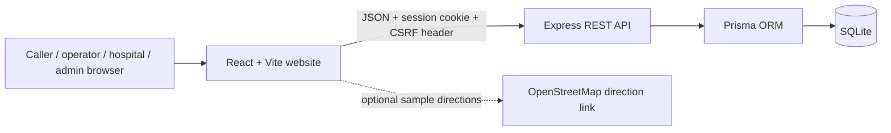

# Responda — Ambulance Dispatch and Hospital Coordination Demo


Responda is a browser-based software engineering minor project that demonstrates a coordinated emergency request workflow for the Chandigarh, Mohali and Panchkula sample area. It shows how a caller request can be matched to a capability-compatible ambulance and a sample hospital, then confirmed and updated by provider dashboards.

## Features

- Public emergency and requirement-based request forms with sample locations.
- Deterministic ambulance matching using availability, required capabilities and Haversine distance.
- Hospital matching using emergency department status, specialties, sample capacity, ownership and distance preferences.
- Ambulance offer accept/decline with two-minute expiry and next-candidate retry.
- Hospital proposal accept/decline with transactional sample-capacity holds.
- Protected case status lookup using a reference and private token.
- Operator and hospital dashboards with in-app notifications and periodic refresh.
- Admin dashboards for cases, fleet, facilities, user accounts, reports, manual assignment, cancellation and audit history.
- Session cookies stored in SQLite, CSRF token checks, password hashing, role/ownership authorization and rate limits.
- Vitest unit/UI tests and Supertest API tests.

## Technology stack

| Layer | Technologies |
|---|---|
| Frontend | React 19, Vite 8, JavaScript, React Router 7, Tailwind CSS 4, Axios, Lucide React |
| Backend | Node.js, Express 5, JavaScript REST API, Zod validation |
| Database | SQLite with Prisma ORM 7 with SQLite driver adapter and migrations |
| Authentication | SHA-256 hashed opaque session identifiers in SQLite, HTTP-only SameSite cookies, bcryptjs password hashes, CSRF token checks |
| Testing | Vitest, React Testing Library, Supertest |

The project uses one frontend, one Express API and one SQLite database. It does not use microservices, Redis, PostGIS or native mobile apps.

## Architecture overview



## Folder structure

```text
.
├── client/
│   ├── public/
│   └── src/
│       ├── components/     # common controls, layout, forms, maps, dashboards
│       ├── context/        # signed-in user state
│       ├── hooks/          # polling and shared UI hooks
│       ├── pages/          # public, operator, hospital and admin pages
│       ├── routes/         # role-protected routes
│       ├── services/       # Axios API client
│       ├── styles/
│       ├── test/
│       └── utils/
├── server/
│   ├── prisma/             # schema, checked-in migration and seed
│   ├── scripts/            # isolated test database runner
│   ├── src/
│   │   ├── config/
│   │   ├── controllers/
│   │   ├── database/
│   │   ├── middleware/
│   │   ├── routes/
│   │   ├── services/       # matching, dispatch, hospital, admin, notifications
│   │   └── utils/
│   └── tests/
├── docs/
├── COMPLETE_PROJECT_SPECIFICATION.md
└── README.md
```

## Prerequisites

- Node.js 20.19 or newer (Node.js 24 LTS/current is recommended).
- npm 10 or newer.
- Windows, macOS or Linux.

## Installation

From the repository root:

```bash
npm install
```

Create the backend environment file:

```bash
cp server/.env.example server/.env
```

On Windows PowerShell, use:

```powershell
Copy-Item server/.env.example server/.env
```

### One-click Windows launcher

Double-click [`START_DEMO.bat`](START_DEMO.bat) in Windows Explorer. It checks Node.js and npm, installs dependencies when needed, creates `server/.env` if it is missing, prepares the SQLite database, starts the website and API, waits for them to respond, and opens the caller pages plus prefilled operator, hospital and administrator sign-in tabs in the default browser. It keeps existing demo data when run again; it seeds the sample accounts only when creating the database for the first time.

The launcher opens one browser profile. Sign in to one staff role at a time and sign out before switching roles. Run [`STOP_DEMO.bat`](STOP_DEMO.bat) to stop the local website and API. Logs are saved under `tmp/`.

Before hosting the app, replace `SESSION_SECRET` in `server/.env` with a long random value. The example is for local development only.

## Database setup

The database URL in `server/.env.example` points to `server/prisma/dev.db`.

```bash
npm run db:generate
npm run db:migrate
npm run db:seed
```

Or run the combined setup:

```bash
npm run db:setup
```

`db:seed` intentionally resets the **demo database contents** and recreates the sample accounts, vehicles, facilities and example cases. Do not run it if you need to keep local case data.

To apply checked-in migrations in a deployment environment, run `npx prisma migrate deploy` from `server/` after setting `DATABASE_URL`. For a local schema reset, `npm run db:reset` deletes and recreates the development data.

## Run the project

From the repository root:

```bash
npm run dev
```

- Website: <http://localhost:5173>
- REST API: <http://localhost:4000/api>
- Health check: <http://localhost:4000/api/health>

Vite proxies `/api` calls to the backend, so the browser uses same-origin API paths during development.

Build the frontend:

```bash
npm run build
```

## Demo accounts

All sample accounts share the local demonstration password **`DemoAccess!2026`**.

| Role | Email |
|---|---|
| Administrator | `admin@demo.local` |
| Operator — AMB-101 | `operator1@demo.local` |
| Operator — AMB-202 | `operator2@demo.local` |
| Operator — AMB-303 | `operator3@demo.local` |
| Hospital — Tricity General | `hospital1@demo.local` |
| Hospital — Mohali Community | `hospital2@demo.local` |
| Hospital — Panchkula Heart and Children | `hospital3@demo.local` |

These credentials are synthetic and intended for a local classroom presentation. Change or remove them before exposing a deployment to the public internet.

## Tests

Run the complete test suite:

```bash
npm test
```

Run each suite independently:

```bash
npm run test:server
npm run test:client
```

The server runner creates and seeds `server/prisma/test.db`, which is separate from `dev.db` and ignored by Git. It tests auth, permissions, request validation, matching, accept/decline, hospital capacity, lifecycle transitions, private lookup, idempotency, completion and resource release.

## API and design documentation

- [API documentation](docs/API_DOCUMENTATION.md)
- [Database design](docs/DATABASE_DESIGN.md)
- [Architecture](docs/ARCHITECTURE.md)
- [User guide](docs/USER_GUIDE.md)
- [Complete project specification](docs/COMPLETE_PROJECT_SPECIFICATION.md)

## Screenshots

Add screenshots here after running the local demo. Use only synthetic data.

<!-- Screenshot placeholder: landing page -->
<!-- Screenshot placeholder: operator dashboard -->
<!-- Screenshot placeholder: hospital dashboard -->
<!-- Screenshot placeholder: administrator dashboard -->

## Limitations

- Sample coordinates and a simple Tricity bounding box are used instead of browser GPS or a production service polygon.
- Haversine distance and a fixed 30 km/h estimate are used; no live traffic or route calculation is performed.
- Provider notifications are stored in the app database and dashboard pages poll periodically. No SMS, push or WebSocket messages are sent.
- Bed counts are manually updated sample values. The application does not reserve actual hospital beds.
- ERSS 112, dispatch authorities and hospital systems are not connected.
- The system is not clinically validated, monitored, or suitable for operational emergency use.
- SQLite and a single server are suitable for the minor project demo, not a high-availability regional emergency service.

## Academic project disclaimer

This repository is an educational demonstration of software engineering concepts. It must not be used to contact emergency services, make clinical decisions, dispatch a vehicle, or represent real hospital capacity. In a real emergency, contact the appropriate local emergency service directly.

## GitHub upload

Create an empty GitHub repository. For a fresh copy (such as one extracted from the ZIP), run these commands from the project folder. If Git is already initialized, skip `git init`:

```bash
git init
git add .
git commit -m "Build ambulance dispatch coordination demo"
git branch -M main
git remote add origin https://github.com/<your-account>/<your-repository>.git
git push -u origin main
```

Do not commit `.env`, SQLite database files, `node_modules`, build output or real health data. These paths are excluded by `.gitignore`.

## License

MIT. See [LICENSE](LICENSE).

