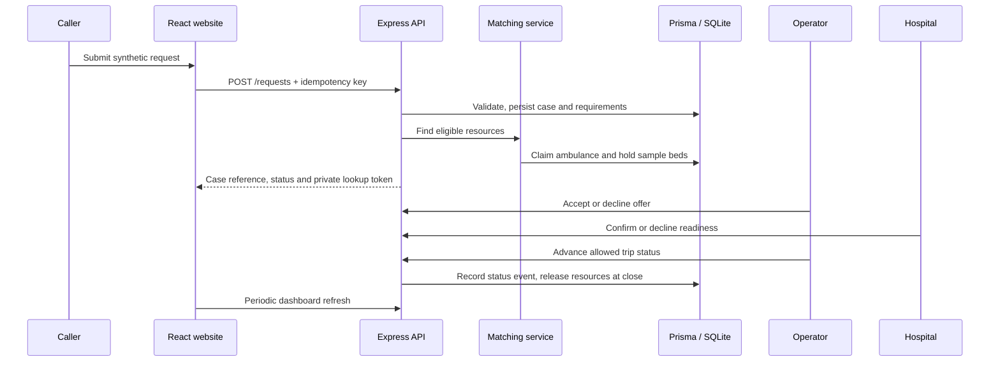

# Architecture

## Runtime components

1. **React/Vite client:** One responsive website serves the public caller flow and all signed-in roles. React Router protects workspaces. Tailwind CSS provides responsive styles. Axios calls `/api` with credentials and CSRF headers.
2. **Express API:** One Node.js process owns validation, sessions, role checks, matching, state transitions, notifications, reporting and admin operations. Routes/controllers remain separate from domain services.
3. **Prisma/SQLite:** Prisma provides typed database access and transaction support for the single local SQLite database.
4. **OpenStreetMap link:** The UI can open a directions URL from sample coordinates. No route is requested from an engine; ETA is calculated using a fixed demonstration speed.

## Request flow

## Matching policy

Eligibility is evaluated before ranking. Ambulances must be available, in service, linked to an active operator account and satisfy every requested capability. Hospitals must be active, have the ER enabled, have an active staff account, satisfy the specialty/ownership/distance filters, and have emergency plus requested ICU/ventilator demo capacity.

Candidates sort by approximate distance; ties prefer fewer unnecessary capabilities/specialties and then a stable call-sign/name order. The original weighted formula had undefined scale and direction, so this demo uses these explicit deterministic rules. ETA is a separate rough display estimate at 30 km/h.

## Authentication and security

- Login credentials are checked against bcrypt hashes.
- The browser receives an opaque HTTP-only, SameSite Strict cookie. The database stores only its SHA-256 hash and expiration.
- Mutating routes require a CSRF token associated with the server session.
- Operator and hospital route responses are scoped to their linked provider. Admin access is role-gated.
- Public lookup requires both a random reference and an HMAC-derived private token; only the hash is stored.
- Login, public request creation and lookup endpoints have rate limits.
- Helmet headers, JSON body size limits, Zod validation and parameterized Prisma queries are used.

## Notifications

Notifications are persisted in SQLite for the relevant operator, hospital staff and admins. Dashboard clients refresh periodically. Notification delivery is best effort: a notification failure does not reverse a committed case update.

## Deployment shape

For the classroom demo, run the Vite dev server and Express API locally. For a hosted presentation, build the React app as static files and host it behind the same origin/reverse proxy as `/api`; use HTTPS, a private demo audience, a non-example session secret, seeded synthetic data and a protected SQLite file. No high-availability or operational service guarantee is claimed.

## Explicitly excluded integrations

No native APK, live GPS, OSM routing engine, traffic feed, SMS/push provider, hospital information system, actual bed reservation or ERSS 112 connection is implemented.
