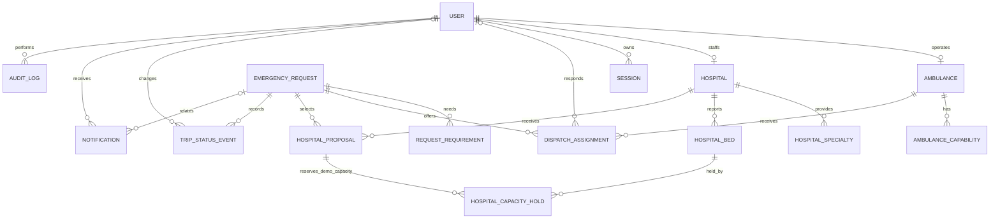

# Database Design

The database uses SQLite and Prisma ORM. Identifiers are integer primary keys except `Session.id`, which is a random UUID string. Every timestamp uses UTC `DateTime` values as written by Prisma. Capability, role and state values are strings checked by server validation because SQLite does not enforce Prisma enums.

## Models

| Model | Purpose | Key fields / relationships |
|---|---|---|
| `User` | Provider and admin identity | Unique email; bcrypt password hash; role; unique optional ambulance/hospital link; active state. |
| `Session` | Opaque server-side session | SHA-256 token hash, CSRF token, nullable user link, expiry. Raw cookie token is never stored. |
| `Ambulance` | Sample vehicle directory | Unique call sign, type, current status, coordinates, service flag, capabilities and historical assignments. |
| `AmbulanceCapability` | Vehicle capability join | Composite key (`ambulanceId`,`capability`). |
| `Hospital` | Sample receiving facility | Name, ownership, coordinates, ER enabled, active flag, specialty and bed rows. |
| `HospitalSpecialty` | Hospital specialty join | Composite key (`hospitalId`,`specialty`). |
| `HospitalBed` | Sample bed counts | Unique hospital/bed type, total count, held count and updater. `available = totalCount - heldCount`. |
| `EmergencyRequest` | Caller case | Unique public reference and idempotency key; hashed lookup token; location, requirements, filters and status. |
| `RequestRequirement` | Request capability join | Composite key (`requestId`,`capability`). |
| `DispatchAssignment` | Ambulance offer and response history | Request, ambulance, operator, offer state, expiry, current flag and decline reason. |
| `HospitalProposal` | Hospital selection history | Request, facility, state, bed-hold flag, current flag and decline reason. |
| `HospitalCapacityHold` | Per-bed temporary hold | Links one proposal to one bed; nullable `releasedAt`. Multiple required bed types can be held for one proposal. |
| `TripStatusEvent` | Immutable case history | Old/new status, actor, note and timestamp. |
| `Notification` | In-app alerts | User, optional request, message and read timestamp. |
| `AuditLog` | Sensitive administration/provider changes | Actor, action, entity and reason. No password or lookup token is stored. |

## Relationships

- One ambulance has one demo operator account; one hospital has one demo staff account. Admin accounts have no provider link.
- Ambulances and capabilities are many-to-many through `AmbulanceCapability`.
- Hospitals and specialties are many-to-many through `HospitalSpecialty`.
- A hospital has many `HospitalBed` rows; one row per bed type.
- One request has many requirements, assignment offers, hospital proposals, trip events and notifications.
- One proposal can hold several bed types through `HospitalCapacityHold`.
- An ambulance can have many historical assignments but only one current active assignment is allowed by service transactions.

## Integrity, indexes and transactions

Prisma adds foreign keys, unique constraints for emails/call signs/references/idempotency keys, and indexes on status, expiry, ownership and foreign-key lookup paths. The service layer enforces non-negative capacity, `heldCount <= totalCount`, coordinate ranges, role/resource links, capability matching and lifecycle transitions.

Assignment and capacity changes use Prisma transactions. A conditional `updateMany` claims an ambulance only when it remains available. Capacity rows are updated only when their previously read count is still current. Decline, timeout, cancellation and completion release active holds.

SQLite cannot express every cross-row rule as a simple schema constraint. API-level validation and transaction checks are therefore part of the data integrity design.

## ER diagram

## Database files

The checked-in schema is `server/prisma/schema.prisma`; the initial SQL migration is in `server/prisma/migrations/20261102000100_init/`. `dev.db` and `test.db` are local files and must not be committed.
